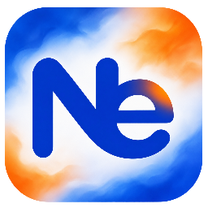

<p align="center">
  
</p>

<h1 align="center">NEO</h1>

<p align="center">
  A lightweight, native Windows AI companion powered by llama.cpp.
</p>

<p align="center">
  <a href="#english">English</a> · <a href="#arabic">العربية</a>
</p>

<p align="center">
  
  
  
  
  
</p>

---

<a id="english"></a>

## English

NEO is a Windows 11 assistant designed to stay close at hand. A floating orb opens a focused chat panel for local AI conversations, voice, and attachments.

### Highlights

- Native **C#**, **WPF**, and **.NET 10** application.
- Local inference through **llama.cpp**; NEO can manage the existing server automatically.
- Floating assistant, resizable chat panel, Markdown replies, and file or image attachments.
- Realtime microphone capture and generated speech playback using Windows audio APIs.
- Local-first: models stay on your machine; NEO does not bundle or download them.

> **Voice status:** generated audio playback has been observed. Microphone-to-model speech understanding still needs verification on the target Windows device. Full-duplex interruption is not currently supported.

### Requirements

- Windows 11 x64
- .NET 10 SDK
- An installed llama.cpp server and a compatible model for inference. NEO does not download models.

### Build, test, and run

Run these commands from the repository root in PowerShell:

```powershell
dotnet restore NEO.sln
dotnet build NEO.sln -c Release
dotnet test NEO.sln -c Release
dotnet run --project src/App/NEO.csproj -c Release
```

To build and publish the Windows x64 package locally:

```powershell
powershell -ExecutionPolicy Bypass -File .\scripts\build-windows.ps1
```

The package is written to `artifacts/NEO-win-x64/`. Windows builds do not depend on GitHub Actions.

### Local server and settings

By default, NEO looks for the existing LFM3-Omni-2B model and projector under your LM Studio models directory, and connects to `127.0.0.1:8081`. When automatic server management is enabled, NEO starts the installed llama.cpp server if needed and reuses a compatible server already running. This option can be disabled in the in-app settings.

Settings and diagnostic logs are stored under `%LOCALAPPDATA%\NEO\`. Logs do not intentionally include conversation text or raw audio. See [server management](docs/server-management.md) for paths, ownership, and configuration details.

### Documentation

- [Architecture](docs/architecture.md)
- [Development guide](docs/development.md)
- [Realtime protocol audit](docs/realtime-protocol.md)
- [Verification record](docs/verification.md)
- [Contributing](CONTRIBUTING.md)
- [Third-party notices](THIRD-PARTY-NOTICES.md)

NEO's original source code is licensed under **Apache-2.0**; see [LICENSE](LICENSE). Third-party dependencies, llama.cpp, and model weights have their own terms. See [third-party notices](THIRD-PARTY-NOTICES.md).

Open the panel by clicking the orb or pressing **Ctrl+Alt+Space**. Press **Escape** to hide it; use the tray menu to quit NEO.

---

<a id="arabic"></a>

<div dir="rtl" align="right">

## العربية

**NEO** مساعد ذكاء اصطناعي خفيف لنظام Windows 11، يبقى قريباً منك عبر دائرة عائمة تفتح نافذة محادثة مستقلة للنص والصوت والمرفقات. يعمل الاستدلال محلياً باستخدام llama.cpp.

### المزايا

- تطبيق أصلي مبني باستخدام **C# وWPF و.NET 10**.
- تشغيل النماذج محلياً عبر **llama.cpp**، مع إمكانية إدارة الخادم تلقائياً.
- واجهة عائمة ونافذة محادثة قابلة لتغيير الحجم، مع دعم Markdown وإرفاق الملفات والصور.
- التقاط صوت المايك وتشغيل الصوت المولّد باستخدام واجهات Windows الصوتية.
- يحافظ على النماذج محلياً؛ التطبيق لا يضمّنها ولا ينزّلها.

> **حالة الصوت:** تم رصد تشغيل صوت مولّد. ما زال التعرّف على الكلام من المايك بحاجة إلى تحقق على جهاز Windows المستهدف. المقاطعة الصوتية الكاملة أثناء تحدث المساعد غير مدعومة حالياً.

### المتطلبات

- Windows 11 بمعمارية x64
- حزمة تطوير .NET 10
- خادم llama.cpp ونموذج متوافق للاستدلال. لا يقوم NEO بتنزيل النماذج.

### البناء والاختبار والتشغيل

نفّذ الأوامر التالية من مجلد المشروع في PowerShell:

```powershell
dotnet restore NEO.sln
dotnet build NEO.sln -c Release
dotnet test NEO.sln -c Release
dotnet run --project src/App/NEO.csproj -c Release
```

لبناء ونشر نسخة Windows x64 محلياً:

```powershell
powershell -ExecutionPolicy Bypass -File .\scripts\build-windows.ps1
```

تُحفظ النسخة في `artifacts/NEO-win-x64/`. بناء Windows لا يعتمد على GitHub Actions.

### الخادم والإعدادات المحلية

افتراضياً يبحث NEO عن نموذج LFM3-Omni-2B وملف الإسقاط الموجودين في مجلد نماذج LM Studio، ويتصل بالخادم على `127.0.0.1:8081`. عند تفعيل الإدارة التلقائية، يشغّل NEO خادم llama.cpp المثبّت عند الحاجة، ويعيد استخدام الخادم المتوافق إذا كان يعمل مسبقاً. يمكن إيقاف هذا الخيار من إعدادات التطبيق.

تُحفظ الإعدادات والسجلات في `%LOCALAPPDATA%\NEO\`. لا يُفترض أن تتضمن السجلات نص المحادثة أو الصوت الخام. راجع [إدارة الخادم](docs/server-management.md) لمعرفة المسارات والإعدادات وآلية إدارة العمليات.

### التوثيق

- [البنية المعمارية](docs/architecture.md)
- [دليل التطوير](docs/development.md)
- [تدقيق بروتوكول الصوت اللحظي](docs/realtime-protocol.md)
- [سجل التحقق والاختبارات](docs/verification.md)
- [المساهمة في المشروع](CONTRIBUTING.md)
- [إشعارات التبعيات الخارجية](THIRD-PARTY-NOTICES.md)

شفرة NEO الأصلية مرخّصة بموجب **Apache-2.0**؛ راجع [ملف الترخيص](LICENSE). للتبعيات الخارجية وllama.cpp وأوزان النماذج شروط تراخيص مستقلة، راجع [إشعارات التبعيات](THIRD-PARTY-NOTICES.md).

افتح نافذة المحادثة بالنقر على الدائرة أو بضغط **Ctrl+Alt+Space**. اضغط **Escape** لإخفائها، واستخدم قائمة شريط المهام لإنهاء التطبيق.

</div>
